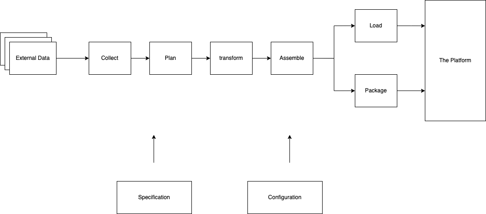

The collections workflow is how data gets onto the platform. It downloads data from external endpoints, transforms it against our specification and configuration, and publishes it in the formats consumers use.

There is one workflow per **collection**, and a collection contains one or more datasets. The DAGs are generated from the specification rather than hand written, so adding a collection to the specification is what creates its workflow.

These pipelines do not have their own unique code. They all run the same processes, and it is the specification and configuration inputs that produce different behaviour for each collection.

## When it runs

The collection DAGs themselves are `schedule=None` — they do not run on their own. They are triggered by `trigger-collection-dags-scheduled`, a "DAG of DAGs" which runs nightly and starts everything in the right order:

1. `organisation-collection`, then `organisation-builder` — most collections need organisation data, so this goes first
2. every collection DAG, in a weighted order so the long running collections start early
3. `build-digital-land-builder`

`trigger-collection-dags-manual` runs the same sequence on demand. Individual collection DAGs can also be triggered by hand during the day.

`title-boundary` is not triggered by either of these. It runs once a month from `trigger-title-boundary-monthly`, which does not wait for it to finish, so the nightly sequence is never held up behind it.

The schedule, and which collections run in a given environment, come from the `config.json` that ships with the deployed DAGs, so they differ between development, staging and production.

## The steps

Each collection DAG is built from these tasks. Where a collection has more than one dataset, the tasks after collect are created once per dataset.

| Task | Runs on | What it does |
|---|---|---|
| `configure-dag` | Airflow | Resolves environment configuration — CPU, memory, VPC and logging settings — and passes it to the tasks below |
| `{collection}-collect` | ECS Fargate | Runs [`bin/collect.sh`](https://github.com/digital-land/collection-task/blob/main/bin/collect.sh): the [collect](/architecture-and-infrastructure/data-pipeline-architecture/processes/collect) process, then the [plan](/architecture-and-infrastructure/data-pipeline-architecture/processes/plan) process (`make collection`), then saves logs, resources and the collection database to S3 |
| `{dataset}-get-transform-batch-configs` | Airflow | Splits the resources that need transforming into batches, so transform can run in parallel |
| `{dataset}-transform` | ECS Fargate | One dynamically mapped task per batch, each running the [transform](/architecture-and-infrastructure/data-pipeline-architecture/processes/transform) process |
| `{dataset}-assemble-load-bake` | EMR Serverless | Runs the assemble job from [pyspark-jobs](https://github.com/digital-land/pyspark-jobs): builds the dataset's `entity`, `fact` and `fact_resource` Delta tables from the transformed files, writes the CSV, JSON, GeoJSON and parquet downloads, and loads the entities into the platform database |
| `{dataset}-package` | ECS Fargate | Runs [`bin/package.sh`](https://github.com/digital-land/collection-task/blob/main/bin/package.sh): builds the dataset's sqlite file for datasette from the Delta tables, and runs the dataset's expectations. Not built for `title-boundary` |
| `{dataset}-tiles-builder` | ECS Fargate | Builds vector tiles with the [tiles-builder-task](https://github.com/digital-land/tiles-builder-task) image, for datasets with the geography typology |

Note that **plan does not have its own task** — it runs inside the collect task, immediately after collecting.

## Where the data goes

The layers below are the ones described in the [data pipeline architecture overview](/architecture-and-infrastructure/data-pipeline-architecture), and correspond to the bronze, silver and gold layers of a medallion architecture.

| Layer | What is stored | Where |
|---|---|---|
| External sources | Nothing — this is the publisher's endpoint | The open internet |
| Raw (bronze) | Collected resources and collection logs, exactly as downloaded | `s3://{env}-collection-data/{collection}/` |
| Cleaned and transformed (silver) | Transformed files, issue logs, and the assembled dataset's Delta tables | `s3://{env}-collection-data/` and `s3://{env}-parquet-datasets/` |
| Consumer (gold) | The published dataset, the platform database and vector tiles | S3, PostGIS, EFS for datasette |

Because raw resources and logs are kept, we can always describe where a value came from and rebuild what came after it.

## Tools and services

* **Airflow** (AWS MWAA) orchestrates the workflow
* **ECS Fargate** runs each task as a container, using the [collection-task](https://github.com/digital-land/collection-task) image
* **EMR Serverless** runs the PySpark assemble job from [pyspark-jobs](https://github.com/digital-land/pyspark-jobs)
* **S3** holds every input and output
* **PostGIS** serves the data to [planning.data.gov.uk](https://www.planning.data.gov.uk)
* **EFS** holds the sqlite files that datasette serves

## Repositories

| Repository | Part it plays |
|---|---|
| [airflow-dags](https://github.com/digital-land/airflow-dags) | Generates and schedules the DAGs |
| [collection-task](https://github.com/digital-land/collection-task) | The container that runs collect, transform and package |
| [digital-land-python](https://github.com/digital-land/digital-land-python) | The implementation of every process |
| [tiles-builder-task](https://github.com/digital-land/tiles-builder-task) | Builds vector tiles from a dataset |
| [digital-land-efs-sync](https://github.com/digital-land/digital-land-efs-sync) | Puts sqlite files where datasette can read them |
| [pyspark-jobs](https://github.com/digital-land/pyspark-jobs) | The EMR Serverless assemble job: Delta tables, published downloads and the platform database load |
